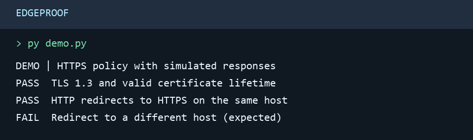

# EdgeProof

Comprueba si tus dominios siguen cumpliendo su política HTTPS después de un despliegue.

Requiere Python 3.11 o posterior. Desde CMD:

    py edgeproof.py --help
    py edgeproof.py verify policy.json --authorized > report.json

Guarda tu política en `policy.json` y sustituye el dominio reservado por uno que administres.

    {"hosts": ["web.example.com"], "min_certificate_days": 14}

Para cada host verifica la cadena y el nombre del certificado, calcula los días restantes y consulta la redirección de la raíz HTTP mediante HEAD. Registra la versión TLS negociada. Una negociación correcta no demuestra que el servidor rechace versiones anteriores. La redirección debe apuntar al mismo nombre por HTTPS y no se sigue. Un servidor que solo redirige peticiones GET puede necesitar una comprobación manual.

Salida JSON. Código 0 si cumple, 1 si incumple y 2 si hubo errores de conexión o configuración.

Referencia: [TLS en Python](https://docs.python.org/3/library/ssl.html).

## Demo reproducible

Ejecuta `py demo.py` para comprobar el comportamiento con datos de prueba.

